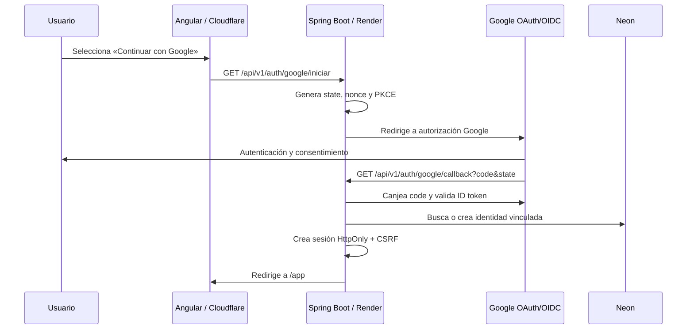

# Evaluación: Google Sign-In, propuesta distintiva y evolución de landing

**Producto:** Enarmcito  
**Fecha:** 30 de octubre de 2026  
**Estado:** Documento de decisión previo a desarrollo. No modifica la aplicación.

## 1. Resumen ejecutivo

Sí es viable integrar **Iniciar sesión con Google** usando los tiers gratuitos actuales:

- **Cloudflare Pages** puede alojar el frontend HTTPS y el botón de inicio de sesión.
- **Render** puede ejecutar el callback OAuth/OIDC y validar los tokens de Google en Spring Boot.
- **Neon** puede almacenar de forma persistente la identidad externa vinculada a cada cuenta.

Ninguno de esos proveedores es, por sí mismo, un proveedor de identidad. Google será el proveedor de identidad y el backend seguirá siendo la autoridad que crea la sesión, asigna rol y tier, y aplica permisos. La integración no requiere cambiar de hosting ni contratar un servicio de autenticación de terceros.

La limitación principal no es la capacidad técnica ni el tier gratuito: es operar el flujo con dominios estables, cookies seguras, CORS estricto, credenciales OAuth separadas por ambiente y una política clara de vinculación de cuentas.

El módulo editorial propuesto resuelve la operación de crear, revisar, publicar y mantener artículos, GPC y recursos visuales. Aún no resuelve por sí solo el acompañamiento de preparación ENARM: rutas de estudio, evaluación, interacción, sesiones en vivo, recordatorios ni comunidad. La oportunidad distintiva es construir una experiencia basada en **decisiones clínicas navegables, evidencia y actualización trazable**, no copiar una plataforma de videoclases.

## 2. Viabilidad de Google Sign-In con el stack gratuito

| Componente actual | Papel en Google Sign-In | ¿Bloquea el tier gratuito? | Decisión |
|---|---|---|---|
| Cloudflare Pages | Sirve Angular por HTTPS y, opcionalmente, un proxy `/api`. | No. El frontend estático y HTTPS son compatibles con Google Identity Services. | Compatible. |
| Render Free Web Service | Ejecuta Spring Boot, callback OAuth y creación de sesión. | No, pero el servicio se suspende tras 15 min sin tráfico; el primer login posterior puede tardar alrededor de un minuto. | Compatible para demo/primeros usuarios; no para expectativa de disponibilidad continua. |
| Neon Free | Guarda usuario local y la vinculación con Google. | No. La carga de autenticación es pequeña; hay que vigilar el límite de almacenamiento. | Compatible y preferible a una base temporal. |
| Google OAuth 2.0 / Google Identity Services | Autentica con cuenta Google. | No depende de Render, Neon o Cloudflare. Requiere un proyecto de Google Cloud, pantalla de consentimiento y cliente OAuth por ambiente. | Compatible. |
| GitHub Actions Free | Prueba y despliega la integración. | No bloquea la autenticación, pero la cuota para repos privados es limitada. | Compatible si CI es breve. |

Google exige que la aplicación configure credenciales OAuth, orígenes JavaScript y URI de retorno autorizados; una URI que no coincida exactamente produce `redirect_uri_mismatch`. El flujo debe usar HTTPS y mecanismos anti-falsificación/replay como `state` y `nonce`. [Google OpenID Connect](https://developers.google.com/identity/openid-connect/openid-connect), [políticas OAuth](https://developers.google.com/identity/protocols/oauth2/policies)

La opción recomendada es implementar directamente **OpenID Connect con Google Identity Services**. No hace falta adoptar Identity Platform/Firebase Authentication para un único proveedor Google. Si posteriormente se adopta Identity Platform para múltiples proveedores, su tabla actual indica 50,000 usuarios activos mensuales gratuitos para proveedores sociales de Tier 1, pero eso añade dependencia y se debe volver a validar al tomar la decisión. [Identity Platform pricing](https://cloud.google.com/identity-platform/pricing)

### Limitantes concretas del plan gratuito

1. **Disponibilidad del backend.** Render Free suspende servicios sin tráfico tras 15 minutos; el login puede sufrir arranque lento. Esto no invalida OAuth, pero degrada el primer acceso. [Render Free](https://render.com/docs/free)
2. **URLs que pueden cambiar.** Las URL `*.pages.dev` y `*.onrender.com` sirven para pruebas, pero al cambiar de proyecto o dominio habrá que registrar de nuevo cada origen y callback exacto en Google.
3. **Sesiones entre dominios.** Un frontend `pages.dev` y API `onrender.com` son orígenes distintos. Las cookies de sesión y CSRF deben tratarse con especial cuidado; ver sección 4.
4. **Capacidad de base de datos.** Neon Free ofrece actualmente 1 GB por proyecto. Las identidades ocupan poco, pero auditoría, contenido enriquecido y medios no deben guardarse como binarios en PostgreSQL. [Neon Free](https://neon.com/blog/neon-free-plan-1-gb-per-project)
5. **Sin garantía de producción.** No hay SLA, backups administrados ni soporte de incidentes apropiado para prometer disponibilidad. El ambiente público se debe describir como beta mientras use esta combinación.
6. **Uso de Google.** Se necesitan política de privacidad, información de contacto y marca verificable en la pantalla de consentimiento. Sólo se deben pedir los scopes mínimos: `openid`, `email` y `profile`.

## 3. Decisión técnica recomendada para la autenticación

### Flujo

Se recomienda **Authorization Code Flow con PKCE y backend como cliente confidencial**:



El frontend no recibe ni almacena el `client_secret`, refresh token ni credenciales de Google. El backend valida firma, `iss`, `aud`, expiración, `nonce` y el estado; después crea la misma sesión local que el login de contraseña ya utiliza.

### Endpoints propuestos

| Método | Endpoint | Propósito |
|---|---|---|
| `GET` | `/api/v1/auth/google/iniciar` | Crea estado PKCE/nonce y redirige a Google. |
| `GET` | `/api/v1/auth/google/callback` | Valida respuesta, vincula/crea cuenta y crea sesión. |
| `POST` | `/api/v1/me/identidades/google/desvincular` | Desvincula Google sólo si la cuenta conserva otro método de acceso válido. |
| `GET` | `/api/v1/me/identidades` | Muestra métodos vinculados sin exponer secretos. |

El registro por correo/contraseña existente se mantiene. Google se añade como método alternativo, no como reemplazo ni como fuente de roles o tiers.

### Datos a añadir

Crear una tabla separada, por ejemplo `usuario_identidad_externa`:

| Campo | Regla |
|---|---|
| `id` | UUID, PK. |
| `usuario_id` | FK al usuario local. |
| `proveedor` | Inicialmente sólo `GOOGLE`; permite ampliar sin rediseño. |
| `subject` | Valor `sub` inmutable de Google; único junto con proveedor. Nunca usar correo como identificador externo. |
| `correo_verificado` | Correo informado por el token para visualización/auditoría. |
| `email_verified` | Copia del claim validado durante el último acceso. |
| `created_at`, `last_login_at` | Trazabilidad. |

No guardar contraseña Google, token de acceso ni refresh token si la plataforma sólo necesita autenticación. No se requieren permisos para Google Drive, Calendar, YouTube u otras APIs.

### Política de vinculación segura

- Si `(proveedor=GOOGLE, subject)` existe, iniciar sesión en su usuario local asociado.
- Si no existe y el correo verificado coincide con una cuenta local, **no vincular automáticamente sólo por correo**. Solicitar que el usuario pruebe posesión del método existente —inicio de sesión normal o correo de verificación— y entonces vincular Google. Esta regla evita apropiación de cuenta por coincidencias de correo o cambios de proveedor.
- Si no existe cuenta local, crear cuenta `ALUMNO`, con tier gratuito y estado activo; pedir sólo los datos de perfil indispensables que no entregue Google.
- Google nunca puede asignar `ADMIN`, `SUPER_ADMIN`, un tier de pago ni permisos editoriales.
- Registrar la creación, vinculación, intento fallido y desvinculación en auditoría, sin registrar tokens ni códigos OAuth.
- No permitir desvincular Google si es el último método de autenticación de la cuenta.

## 4. Configuración por ambiente y secretos

Crear dos clientes OAuth web distintos dentro del mismo proyecto Google Cloud o en proyectos separados. Separarlos reduce el riesgo de que una URL de pruebas tenga permiso de redirigir a producción.

| Dato | `dev` | `prod` |
|---|---|---|
| Cliente OAuth | `enarmcito-web-dev` | `enarmcito-web-prod` |
| Origen JavaScript autorizado | URL HTTPS exacta de frontend dev | URL HTTPS exacta de frontend prod |
| Redirect URI autorizado | `https://<api-dev>/api/v1/auth/google/callback` o URL de proxy | `https://<api-prod>/api/v1/auth/google/callback` o URL de proxy |
| Base de datos | Neon `enarmcito-dev` | Neon `enarmcito-prod` |
| Secreto | Sólo Render dev / environment GitHub dev | Sólo Render prod / environment GitHub prod |

Secretos de backend requeridos:

```text
GOOGLE_OAUTH_CLIENT_ID
GOOGLE_OAUTH_CLIENT_SECRET
GOOGLE_OAUTH_REDIRECT_URI
GOOGLE_OAUTH_ISSUER=https://accounts.google.com
```

Los secretos pertenecen al servicio Render de cada ambiente. Si se usan GitHub Environments, los secretos de `dev` y `prod` deben ser distintos. El `client_id` puede estar en el frontend sólo si se utiliza el botón oficial, pero el `client_secret` nunca sale del backend.

### Cookies, CORS y proxy

La aplicación actual usa sesión `HttpOnly` y CSRF, una buena base. Antes de OAuth hay que definir uno de estos modelos:

1. **Proxy same-origin recomendado:** Cloudflare Pages expone `/api/*` y reenvía de forma controlada a Render. Angular conserva llamadas relativas a `/api/v1`; cookies y CSRF quedan en el origen de la página.
2. **Dominio propio:** `app.dominio.mx` y `api.dominio.mx`, CORS limitado al origen exacto y cookie `Secure` con atributos revisados para subdominios.

No se debe usar `Access-Control-Allow-Origin: *` junto con credenciales. Tampoco se debe asumir que una cookie `SameSite=Lax` funcionará de forma consistente desde un `pages.dev` hacia `onrender.com`; los navegadores restringen cada vez más cookies de terceros. Este punto debe validarse en navegador real antes de abrir el registro con Google.

## 5. Pruebas y criterios de aceptación de Google Sign-In

- [ ] Un usuario nuevo puede crear una cuenta de alumno mediante Google y recibe sólo el tier gratuito.
- [ ] Un usuario ya vinculado inicia sesión y llega a la zona privada con sesión HttpOnly funcional.
- [ ] Un intento con `state`, `nonce`, firma, audiencia, emisor o URI de retorno inválidos es rechazado.
- [ ] Un correo existente no se vincula de forma silenciosa; se exige comprobar control de la cuenta existente.
- [ ] El botón y el flujo funcionan en Chrome desktop, Safari iOS y Chrome Android.
- [ ] Logout local no cierra la sesión global de Google; la interfaz lo explica cuando sea necesario.
- [ ] Ningún secreto, token, código OAuth o dato personal aparece en logs, respuestas API o repositorio.
- [ ] Se prueban cuentas bloqueadas, cuentas con rol administrativo y correos no verificados.
- [ ] La API aplica el mismo estado, rol y tier al login Google que al login por contraseña.

## 6. Lectura competitiva y necesidad de producto

La página revisada de García ENARM comunica una preparación integral por fases: temario/calendario, videoclases, repasos en vivo, simuladores, flashcards y recursos de evaluación. También usa planes claros y fechas de acceso. [García ENARM](https://www.garciaenarm.com/#inicio)

No se propone replicar su estética, guion, nombres de secciones, planes ni contenidos. La observación útil es de producto: convierte una biblioteca de recursos en una promesa de progreso acompañado y medible.

### Qué resuelve hoy el módulo de creación de contenido

| Necesidad | Cobertura actual/propuesta | Valor |
|---|---|---|
| Publicar artículos, GPC y material de estudio | Sí, mediante el CMS editorial. | Reduce dependencia de migraciones y permite escalar catálogo. |
| Garantizar procedencia, revisión y vigencia | Sí, con fuentes, revisores, estados y auditoría. | Genera confianza en contenido médico. |
| Explicar temas complejos de manera visual | Sí, con bloques de imagen, diagrama, algoritmo y tabla. | Mejora comprensión y repaso. |
| Diferenciar una GPC de material de estudio | Sí, por tipo, metadatos y flujo de revisión. | Evita presentar apuntes como normativa clínica. |
| Ofrecer una experiencia de estudio personalizada | Parcial. | Existe progreso, pero no plan ni recomendación. |
| Medir dominio para ENARM | No. | Faltan preguntas, simulador, retroalimentación y analítica. |
| Crear acompañamiento o interacción en vivo | No. | Faltan agenda, sesiones, registro, video, moderación y grabaciones. |
| Retener usuarios entre visitas | Parcial. | Hay lectura/progreso, pero no ritmo, metas, recordatorios ni comunidad. |

Conclusión: el CMS es una **capacidad habilitadora**, no la propuesta de valor final. Hace posible publicar una experiencia distintiva; por sí solo no entrega acompañamiento ni práctica deliberada.

## 7. Propuesta distintiva para Enarmcito

La propuesta no debe competir primero por cantidad de videoclases. Debe diferenciarse por la utilidad de llegar desde una duda clínica a una recomendación entendible, revisable y repasable en pocos minutos.

### Posicionamiento propuesto

> **Enarmcito convierte guías y temas clínicos en rutas visuales, verificables y rápidas para decidir qué entender y qué repasar antes del ENARM.**

Pilares:

1. **Evidencia que se puede rastrear.** Cada guía muestra emisor, versión, fuentes, fecha de revisión, alcance y responsable clínico.
2. **Decisión clínica visual.** Algoritmos, tablas comparativas, diagramas y “qué cambia la conducta” en lugar de texto largo sin jerarquía.
3. **Lectura que se ajusta al tiempo.** Vista rápida de 3–5 minutos, desarrollo completo y puntos críticos para guardia/repaso.
4. **Actualización visible.** Una guía vencida no parece vigente: se marca, se revisa y conserva historial de cambios.
5. **Progreso útil, no sólo consumo.** A futuro, una ruta por áreas y debilidades conecta contenido con metas de estudio.

### Capacidades a priorizar después del CMS

| Prioridad | Módulo | Problema que resuelve | Dependencias |
|---|---|---|---|
| 1 | Biblioteca GPC visual y actualizable | Encontrar y entender recomendaciones rápido. | CMS, revisión clínica, medios y buscador. |
| 2 | Rutas de estudio por objetivo | Saber qué estudiar hoy y por qué. | Taxonomía ENARM, progreso y agenda simple. |
| 3 | Casos cortos con razonamiento | Convertir lectura pasiva en decisión clínica. | Motor de preguntas/ramas y revisión médica. |
| 4 | Repaso espaciado de puntos críticos | Recordar lo importante sin rehacer toda la lectura. | Marcadores, notificaciones y analítica. |
| 5 | Calendario de sesiones o “pases de caso” | Generar acompañamiento sin construir streaming propio. | Agenda, registro, enlace externo y moderación. |
| 6 | Simulador y analítica | Medir desempeño y orientar plan. | Banco de preguntas, calificación y seguridad. |

### Clases en vivo: opción realista

No conviene construir videollamadas propias sobre Render/Neon/Cloudflare Free. Streaming, grabación, chat, moderación, escalado y protección de acceso exceden esos tiers y añaden una carga operativa alta.

La primera versión puede resolver la necesidad con un módulo de **agenda de sesiones**:

- Ficha de sesión: tema, especialista, objetivos, fecha, duración y tier requerido.
- Registro con cupo, recordatorio y enlace de proveedor externo autorizado.
- Página de preparación con artículos/GPC relacionados y preguntas previas.
- Grabación o material posterior cuando exista autorización de imagen y derechos.
- Encuesta y resumen editorial al finalizar.

El streaming se integra posteriormente con un proveedor especializado. La plataforma mantiene control de agenda, acceso y aprendizaje; el proveedor de video asume transmisión. Antes de vender una sesión se deben definir costos, límites de asistentes, privacidad, grabación, consentimiento y soporte.

## 8. Evolución propuesta de la landing

### Estado actual

La landing existente ya contiene:

- Hero orientado a lectura guiada y fuentes verificables.
- Vista previa de un artículo.
- Explicación del método de lectura.
- Tarjetas de tiers.
- Llamadas a registro e inicio de sesión.

Es una base limpia, pero no cuenta todavía la historia completa: artículos gratuitos, biblioteca de GPC, recursos visuales, responsables editoriales, actualización, ni el futuro acompañamiento de estudio. Además, un visitante no puede decidir con facilidad qué encontrará ni por qué debe volver.

### Arquitectura de información propuesta

```text
1. Hero: promesa + acceso gratuito a artículos + CTA principal
2. Prueba visual: una guía convertida en algoritmo/tabla + fecha de revisión
3. «Empieza gratis»: artículos y buscador por área
4. «Guías que se pueden verificar»: fuente, vigencia, revisor y alcance
5. «Estudia según tu momento»: lectura rápida, repaso visual, ruta completa
6. Biblioteca por especialidad / áreas ENARM
7. Próximamente: pases de caso o sesiones con especialistas (sin prometer streaming aún)
8. Cómo cuidamos la calidad: proceso editorial y aviso médico
9. Preguntas frecuentes: acceso gratuito, fuentes, vigencia, uso educativo
10. CTA final: explora artículos gratuitos / crea cuenta
```

### Secciones y contenido sugerido

| Sección | Mensaje | Elemento visual/funcional | CTA |
|---|---|---|---|
| Hero | “Entiende la decisión clínica, no sólo memorices el dato.” | Composición original de una ficha de guía con algoritmo y fecha de revisión. | `Explorar artículos gratis` |
| Artículos abiertos | “Empieza sin pagar: artículos breves y verificables.” | Tres tarjetas reales por área, tiempo de lectura y fuente. | `Ver biblioteca` |
| Guías visuales | “De la fuente a un mapa de decisiones.” | Ejemplo ficticio de flujo clínico y comparación de criterios; no usar contenido clínico no revisado. | `Conocer las guías` |
| Método | “Tres niveles para un mismo tema: vistazo, comprensión y repaso.” | Tabs o tarjetas: 3 min / lectura completa / algoritmo. | `Ver cómo funciona` |
| Confianza editorial | “Qué fuente usamos y cuándo se revisó.” | Línea de proceso: autor → revisor médico → publicación → actualización. | `Ver criterios editoriales` |
| Áreas | “Encuentra tu siguiente tema.” | Mosaico con especialidades y contador de recursos, cuando sean datos reales. | `Explorar por área` |
| Acompañamiento futuro | “Pases de caso y sesiones en preparación.” | Calendario de ejemplo claramente marcado como próximo; no inventar fechas, docentes o cupos. | `Quiero enterarme` |
| FAQ y aviso | “Contenido educativo, no atención médica.” | Acordeones accesibles y enlace a política de privacidad. | `Crear cuenta` |

### Principios de diseño

- Mantener la identidad actual sobria y médica; añadir profundidad visual mediante diagramas propios, iconografía coherente y ejemplos de contenido, no fotografías genéricas de batas o quirófanos.
- No copiar colores, textos, secciones, precios, nombres de productos, calendario ni composición del competidor.
- Un solo CTA dominante por sección. Para público nuevo: `Explorar artículos gratis`; para usuarios interesados: `Crear cuenta`.
- No mostrar tiers como oferta central mientras los artículos sean gratuitos. Presentar primero el valor abierto y reservar la explicación de acceso de guías para cuando la política comercial esté definida.
- Usar contenido real revisado o prototipos señalados como demostración. No usar una GPC ni un algoritmo médico como adorno sin fuente y revisión.
- Diseñar primero para móvil: tarjetas apiladas, tabla transformable en comparativa vertical y diagramas con alternativa textual.
- Incluir métricas sólo si son verificables; no inventar número de alumnos, tasa de aprobación, especialistas ni testimonios.

## 9. Roadmap recomendado

### Fase A — Fundamentos de acceso y confianza

1. Google Sign-In, vinculación segura de cuentas, consentimiento y privacidad.
2. Proxy/sesión same-origin o dominio propio antes de publicar autenticación social.
3. Artículos gratuitos visibles desde la landing y navegación de catálogo público.
4. Página de criterios editoriales y versión inicial de la landing ampliada.

### Fase B — Diferenciación editorial

1. CMS por bloques y carga segura de medios.
2. GPC con fuente, vigencia, revisión clínica, algoritmos y presentación visual.
3. Búsqueda por área, tipo, vigencia y tema.
4. Guardar/seguir temas y progreso básico.

### Fase C — Acompañamiento y práctica

1. Rutas de estudio y metas semanales.
2. Casos clínicos cortos con razonamiento y retroalimentación.
3. Agenda de sesiones; integrar video externo tras validar modelo operativo.
4. Simulador y analítica de desempeño.

## 10. Decisiones pendientes antes de desarrollar

1. ¿El acceso con Google estará disponible para todos desde el lanzamiento o primero en `dev`/beta cerrada?
2. ¿Se mantendrá el login por contraseña como alternativa obligatoria? Propuesta: sí, mientras se valida la vinculación.
3. ¿Se adquirirá un dominio propio antes de abrir Google Sign-In en `prod`? Propuesta: sí; resuelve mejor cookies, marca, privacidad y estabilidad de callbacks.
4. ¿Qué información mínima se solicitará a una persona que llega por Google: nombre, apellido, objetivo ENARM, estado de preparación u otra?
5. ¿Quién aprueba la política de privacidad, términos y pantalla de consentimiento Google?
6. ¿Qué criterio convierte una sesión de “agenda” en una clase en vivo vendible y qué proveedor de video se aprobará?
7. ¿Cuáles son las primeras tres GPC o recursos visuales que demostrarán el valor diferencial?


## 11. Estado de implementación (30 de octubre de 2026)

Implementado y pendiente de probar en `dev`. Sin commit todavía.

### Qué se construyó

- **Backend:** migración `V113__identidad_externa.sql` (tabla `usuario_identidad_externa`; se elimina `ck_usuarios_sistema_password` porque una cuenta creada con Google queda activa sin contraseña), flujo OIDC con PKCE en `auth/Google*`, endpoints de la sección 3 y `GET /api/v1/auth/proveedores`.
- **Frontend:** botón «Continuar con Google» en login y registro (solo si el ambiente tiene Google configurado), tarjeta «Métodos de acceso» en Mi perfil para vincular y desvincular, y la landing ampliada con la arquitectura de la sección 8.
- **Pruebas:** 14 pruebas de integración del flujo (backend, 67 en total) y 32 pruebas de frontend.

### Decisiones tomadas al implementar

- **Redirect URI por el frontend.** Por defecto es `<APP_FRONTEND_ORIGIN>/api/v1/auth/google/callback`: el proxy de Pages lo reenvía a Render y la cookie de sesión queda de primera parte.
- **Vinculación.** Un correo que ya tiene cuenta local no se vincula en silencio: se rechaza con `GOOGLE_CORREO_EXISTENTE` y la persona vincula desde Mi perfil tras iniciar sesión con su contraseña.
- **Cuenta solo de Google.** No puede desvincularse (`SIN_OTRO_METODO_DE_ACCESO`) hasta que tenga contraseña.
- **Sin tokens guardados.** Solo `sub`, correo verificado y fechas.
- **Landing.** No incluye mosaico de áreas ni contadores (no hay datos públicos reales) ni formulario «Quiero enterarme» (no existe lista de espera). El ejemplo de algoritmo del hero es ilustrativo y sin contenido clínico.

### Configurar Google en `dev`

1. En Google Cloud Console, crea el proyecto y la **pantalla de consentimiento** (scopes `openid`, `email`, `profile`).
2. Crea un **ID de cliente OAuth «Aplicación web»** llamado `enarmcito-web-dev`:
   - Origen JavaScript autorizado: `https://enarmcito-dev.pages.dev`
   - URI de redirección autorizado: `https://enarmcito-dev.pages.dev/api/v1/auth/google/callback`
3. En el servicio Render de `dev`, agrega las variables:
   - `GOOGLE_OAUTH_CLIENT_ID`
   - `GOOGLE_OAUTH_CLIENT_SECRET`
   - (`GOOGLE_OAUTH_REDIRECT_URI` solo si usas otro dominio; por defecto se deduce de `APP_FRONTEND_ORIGIN`.)
4. Despliega. Sin esas variables el botón no aparece.
5. Mientras la pantalla de consentimiento esté en modo «Pruebas», agrega tus correos como usuarios de prueba.

Para `prod`, repite con un cliente distinto (`enarmcito-web-prod`) y sus propias URLs; nunca reutilices el secreto de `dev`.
