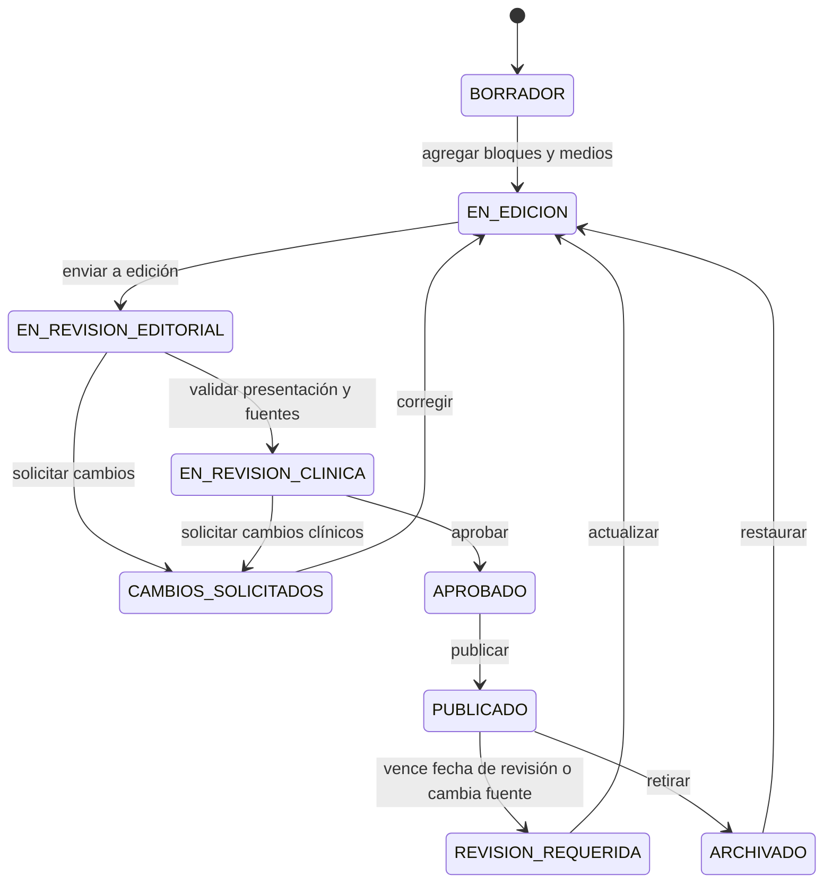

# Módulo de guías de práctica clínica y contenido enriquecido

**Producto:** Plataforma de Medicina  
**Estado:** Definición de entregable — complemento y evolución de `panel-administrativo.md`  
**Fecha:** 29 de octubre de 2026

## 1. Decisión de producto

El catálogo de contenido se divide en tres clases con objetivos y reglas distintos:

| Clase | Propósito | Acceso propuesto | Ejemplo |
|---|---|---|---|
| `ARTICULO` | Divulgación, introducción y lectura breve. | Gratis con cuenta: cualquier cuenta lo lee, sin depender de tier. | Resumen de un tema médico. |
| `GUIA_PRACTICA_CLINICA` | Recurso clínico estructurado, trazable y revisado. | De pago, por tier (Básico, Intermedio o Premium). El editor elige el tier de cada guía; una guía nueva nace en el más bajo. | Guía diagnóstica o terapéutica basada en fuentes oficiales. |
| `RECURSO_ESTUDIO` | Material didáctico complementario que no debe presentarse como GPC. | Siempre del tier Premium. | Material de cirugía general ENARM, atlas, repaso o ficha de estudio. |

**Regla de acceso (vigente desde la migración `V112`).** Todo el catálogo exige cuenta: no existe lectura anónima y la API responde 401 a quien no ha iniciado sesión. Dentro de ello, el acceso lo fija el tipo:

| Tipo | Política | Tier |
|---|---|---|
| `ARTICULO` | `REGISTRADO_GRATUITO` | Ninguno; cualquier cuenta lo lee. |
| `GUIA_PRACTICA_CLINICA` | `POR_TIER` | De pago; el editor elige el tier (por defecto el más bajo activo). |
| `RECURSO_ESTUDIO` | `POR_TIER` | Siempre el tier activo más alto (Premium); no se puede cambiar. |

La API valida esta regla (también con restricciones en base de datos) y la interfaz la comunica; sólo las guías permiten cambiar el tier. Cambiar el tipo de un contenido reasigna el acceso del tipo nuevo. La política `PUBLICO_GRATUITO` ya no existe.

El PDF de **Cirugía General ENARM** se clasifica inicialmente como `RECURSO_ESTUDIO`: puede transformarse en material navegable y visualmente enriquecido, pero no se etiquetará como guía de práctica clínica ni se le atribuirá validez normativa sin una fuente oficial y revisión clínica correspondientes.

## 2. Objetivo del módulo

Permitir que personal médico autorizado cree, revise, publique, actualice y archive guías de práctica clínica y recursos educativos enriquecidos. El resultado se mostrará como una experiencia web legible y dinámica, no como una simple caja de texto ni como un PDF incrustado obligatorio.

El módulo debe soportar:

- Contenido estructurado para GPC, con fuente, vigencia, población objetivo, recomendaciones y nivel de evidencia cuando esté disponible.
- Páginas de estudio enriquecidas compuestas por bloques de texto, imágenes, diagramas, tablas, llamadas de atención, algoritmos y referencias.
- Material derivado de documentos autorizados, como el contenido de cirugía general recibido, conservando procedencia, autoría y derechos de uso.
- Publicación segura: ningún borrador, archivo privado ni contenido sin aprobación se expone mediante rutas públicas o de aprendizaje.

No es un sistema de diagnóstico ni una herramienta para sustituir el juicio clínico. Toda página clínica incluirá un aviso educativo y la fecha de revisión.

## 3. Alcance funcional

### 3.1 Artículos gratis con cuenta

- Todo `ARTICULO` publicado tiene política `REGISTRADO_GRATUITO`: requiere cuenta, pero no tier.
- Sin sesión no se lee ningún contenido; registrarse es gratis y permite guardar el progreso.
- Mantiene la estructura actual de lectura guiada y puede enriquecerse gradualmente con bloques visuales.
- Un artículo no puede convertirse en GPC sólo cambiando su etiqueta: deberá completar los campos clínicos, la revisión y el flujo de aprobación de una guía.

### 3.2 Guías de práctica clínica

Una `GUIA_PRACTICA_CLINICA` contiene, como mínimo:

- Título, slug, especialidad o área médica y resumen ejecutivo.
- Institución u organismo emisor, título de la fuente, URL o DOI, edición o versión, fecha de publicación y fecha de revisión interna.
- Población objetivo, contexto de atención y alcance clínico.
- Fecha de vigencia, próxima revisión y estado de actualización.
- Recomendaciones estructuradas, fuerza/nivel de evidencia cuando la fuente lo proporcione y referencias vinculadas.
- Autor médico, revisor clínico, editor responsable e historial de aprobaciones.
- Aviso de uso educativo y fecha de última actualización visible para la persona lectora.

La guía puede incluir un resumen de lectura rápida, un algoritmo visual y secciones detalladas. El contenido debe citar y enlazar la fuente original; no se deberá afirmar que la plataforma es la institución emisora de la GPC.

### 3.3 Recursos de estudio

`RECURSO_ESTUDIO` admite temarios, apuntes, resúmenes ENARM y otro material educativo. Tendrá título, área, autoría/procedencia, fecha de revisión, aviso de uso educativo y la etiqueta visible **Material de estudio; no es guía de práctica clínica** cuando aplique.

Para incorporar el PDF de Cirugía General ENARM:

1. Se confirma por escrito que existe autorización para reproducir, transformar y publicar su contenido e imágenes.
2. Se registra la fuente, titular de derechos, edición, fecha y responsable editorial.
3. Se fragmenta en páginas o secciones web; no se requiere mostrar el PDF completo.
4. Cada imagen, tabla o diagrama conserva texto alternativo y crédito cuando corresponda.
5. Un médico revisor valida que los resúmenes derivados no agreguen recomendaciones clínicas no sustentadas.

Si no se cuenta con derechos de publicación, el documento sólo puede usarse como referencia interna, nunca como material público ni como fuente para copiar texto o imágenes.

## 4. Modelo de contenido enriquecido por bloques

Cada pieza se compone de una cabecera editorial y una lista ordenada de bloques. Esto evita crear un editor distinto para cada tipo de contenido y permite que las páginas sean dinámicas.

| Bloque | Uso | Reglas principales |
|---|---|---|
| `TEXTO_RICO` | Párrafos, subtítulos, listas y énfasis. | HTML o formato rico sanitizado; no se permite JavaScript ni HTML inseguro. |
| `IMAGEN` | Ilustración, fotografía, infografía o figura. | Archivo optimizado, texto alternativo obligatorio, pie y crédito/fuente cuando aplique. |
| `DIAGRAMA` | Algoritmo, flujo clínico o mapa conceptual. | SVG sanitizado o definición estructurada renderizada por la plataforma; descripción textual obligatoria. |
| `TABLA` | Comparación, dosis de referencia o criterios. | Encabezados accesibles, fuente y nota de alcance; evitar tablas que no funcionen en móvil. |
| `CALLOUT` | Alerta, perla clínica, contraindicación o recordatorio. | Tipo visual semántico; no reemplaza una fuente o revisión clínica. |
| `ALGORITMO` | Decisiones paso a paso. | Nodos y conexiones estructurados, versión, fuente y revisión clínica obligatorias. |
| `ACORDEON` | Detalle opcional para lectura progresiva. | Encabezado descriptivo y contenido accesible por teclado. |
| `REFERENCIAS` | Bibliografía y enlaces. | Datos estructurados; URL/DOI validados cuando se proporcionen. |
| `ADJUNTO` | PDF original u otro material descargable autorizado. | Opcional, escaneado y con control de acceso; no sustituye la versión web. |

El orden de los bloques es editable mediante arrastrar y soltar o controles de mover. Cada bloque tendrá identificador, posición, tipo, datos, estado de publicación y metadatos de accesibilidad. La página pública sólo renderiza bloques publicados y sanitizados.

### Archivos y medios

- Formatos iniciales: JPG, PNG, WebP, SVG sanitizado y PDF autorizado. Video, audio y DICOM quedan fuera de esta entrega.
- Todo archivo se almacenará fuera de la base de datos, en almacenamiento de objetos o servicio equivalente; la base de datos conserva metadatos, relación y permisos.
- Al cargar un archivo se validarán tipo real, tamaño, dimensiones, antivirus/antimalware y derechos de uso declarados. No se confiará únicamente en la extensión del archivo.
- Se generan variantes optimizadas para escritorio y móvil. Los originales quedan protegidos y no se publican automáticamente.
- Las imágenes deben tener texto alternativo; diagramas y algoritmos deben contar además con equivalente textual legible por lector de pantalla.
- Se prohíbe cargar datos de pacientes identificables, imágenes clínicas sin consentimiento documentado o contenido que infrinja derechos de terceros.

## 5. Roles y permisos específicos

Los roles de `panel-administrativo.md` se especializan para este módulo sin alterar los permisos de administración de usuarios.

| Rol | Capacidades sobre artículos | Capacidades sobre guías y recursos | Límites |
|---|---|---|---|
| `AUTOR_CONTENIDO` | Crea y edita borradores propios. | Crea borradores y bloques propios; puede cargar medios pendientes de aprobación. | No publica ni aprueba; no declara por sí mismo una GPC como vigente. |
| `REVISOR_MEDICO` | Revisa contenido asignado. | Revisa exactitud clínica, fuentes, algoritmo y vigencia; aprueba o solicita cambios. | No revisa su propio contenido ni publica. |
| `EDITOR_CONTENIDO` | Gestiona edición y publicación. | Ordena bloques, asigna responsables, verifica créditos y publica contenido clínicamente aprobado. | No puede sustituir la aprobación clínica cuando sea obligatoria. |
| `GESTOR_MULTIMEDIA` | No aplica salvo permiso editorial. | Revisa metadatos, accesibilidad, derechos y optimización de archivos. | No altera contenido clínico, recomendaciones ni estado clínico. |
| `ADMIN_PLATAFORMA` | Gestión completa de operación editorial. | Gestiona catálogo, acceso por tier y publicación, conservando la separación autor–revisor. | No puede omitir la revisión clínica de una GPC. |
| `SUPER_ADMIN` | Acceso total. | Configura políticas, permisos, catálogos y recuperación ante incidentes. | Su acceso queda plenamente auditado. |

Permisos atómicos adicionales propuestos:

- `content.type.assign`, `content.access-policy.assign`
- `guides.create`, `guides.update.own`, `guides.update.any`, `guides.clinical-review`, `guides.publish`, `guides.archive`
- `media.upload`, `media.update`, `media.review`, `media.publish`, `media.archive`
- `blocks.create`, `blocks.update.own`, `blocks.update.any`, `blocks.reorder`
- `algorithms.create`, `algorithms.clinical-review`

La publicación de una GPC exige `guides.publish` **y** una revisión clínica aprobada por una cuenta diferente a la autora. La publicación de un recurso de estudio exige revisión editorial; la revisión clínica será obligatoria si contiene recomendaciones clínicas accionables.

## 6. Flujo editorial y clínico

Reglas:

- Para `ARTICULO`, la revisión clínica puede ser opcional según la política editorial; para `GUIA_PRACTICA_CLINICA` es obligatoria.
- Al editar una guía publicada, la plataforma crea una revisión pendiente. La versión publicada se mantiene visible hasta aprobar la actualización o retirarla explícitamente.
- Toda publicación conserva la versión, responsables, fecha, fuentes y cambios relevantes.
- Una guía con revisión vencida se marca visiblemente como **requiere actualización** y puede retirarse de circulación según la política configurada.
- Archivar es reversible y conserva la trazabilidad. La eliminación física no forma parte de la entrega.

## 7. Modelo de datos propuesto

Se deben versionar estos cambios mediante migraciones y DTOs; no se expondrán entidades directamente.

| Entidad | Campos o propósito clave |
|---|---|
| `contenido` | Añadir `tipo`, `politica_acceso`, `estado_editorial`, `version_publicada`, autor, revisor, editor, vigencia y próximo vencimiento. Política determinada por el tipo (ver sección 1). |
| `contenido_bloque` | `id`, `contenido_id`, posición, tipo, datos estructurados, estado y timestamps. |
| `activo_multimedia` | Archivo, tipo MIME verificado, tamaño, hash, almacenamiento, texto alternativo, pie, crédito, licencia, estado y responsable. |
| `contenido_activo` | Relación entre contenido/bloque y medio, con posición y propósito. |
| `contenido_revision` | Versión, tipo de revisión, dictamen, comentarios, revisor, fecha y relación con el contenido. |
| `contenido_referencia` | Fuente estructurada, URL/DOI, emisor, fecha y etiqueta de evidencia cuando exista. |
| `algoritmo_clinico` | Definición de nodos y conexiones, fuente, versión, revisión y estado. Puede vincularse a un bloque. |
| `auditoria_evento` | Actor, acción, recurso, fecha, motivo y diferencias seguras para contenido, medios y publicaciones. |

Los contenidos vigentes se migraron a `ARTICULO`, preservando slug, progreso y URLs; la migración `V112` normalizó su acceso a la regla por tipo.

## 8. API y presentación pública

Se mantendrá el prefijo `/api/v1` y se separarán los contratos públicos de los administrativos.

| Área | Ejemplos de endpoints | Regla |
|---|---|---|
| Catálogo público | `GET /content`, `GET /content/{slug}` | Exige sesión. Devuelve los artículos publicados y las guías/recursos cuyo tier cubre el de la cuenta. |
| Administración de contenido | `/api/v1/admin/contenido` | Filtros por tipo, estado, autor, revisor, vigencia y acceso; CRUD editorial por permiso. |
| Bloques | `/api/v1/admin/contenido/{id}/bloques` | Crear, editar, ordenar y retirar bloques según permiso. |
| Medios | `/api/v1/admin/media` | Carga controlada, consulta de estado, revisión, asociación y archivado. |
| Revisión | `/api/v1/admin/contenido/{id}/revisiones` | Solicitar, aprobar o devolver con comentarios y evidencia de decisión. |
| Publicación | `/api/v1/admin/contenido/{id}/publicar` | Comprueba transición, aprobaciones, campos obligatorios y permisos. |

En el frontend, una página de contenido renderiza cada bloque mediante un componente específico. Esto permite una experiencia visual rica sin permitir HTML arbitrario ni scripts de terceros. El diseño debe ser responsivo, mantener lectura lineal en móvil y cargar imágenes de forma diferida sin ocultar información esencial.

## 9. Criterios de aceptación

- Todo artículo publicado es gratis con cuenta y puede consultarse sin que el tier limite su acceso; sin sesión no se accede a ningún contenido.
- Las guías son siempre por tier y el editor elige cuál; los recursos de estudio son siempre Premium; ningún usuario obtiene contenido restringido manipulando la interfaz.
- Un autor crea una guía o recurso con bloques de texto, imagen, diagrama, tabla y referencias; el orden definido se conserva al publicarse.
- Toda imagen publicada tiene texto alternativo y todos los diagramas/algoritmos tienen equivalente textual.
- La carga de medios valida archivo, tamaño y tipo real, registra crédito/licencia y no deja públicos archivos pendientes de revisión.
- Una GPC no puede publicarse sin fuente, vigencia, fecha de revisión y aprobación clínica realizada por una persona diferente a la autora.
- Un recurso derivado del PDF de cirugía se identifica como material de estudio, muestra procedencia y no se etiqueta como GPC sin el proceso clínico correspondiente.
- Una actualización de guía publicada conserva una versión pública estable mientras la nueva pasa por revisión.
- Al archivar contenido, deja de aparecer en los catálogos correspondientes sin borrar su historial, auditoría ni relaciones necesarias.
- Todas las transiciones de estado y decisiones de revisión quedan auditadas; no se guardan contraseñas, tokens ni datos clínicos identificables.
- Hay pruebas automatizadas de autorización, sanitización de bloques, carga de archivos, publicación, revisión clínica, control de acceso y archivado.

## 10. Fuera de alcance inicial

- Generación automática de diagramas o contenido clínico mediante IA.
- Edición colaborativa en tiempo real y comentarios al estilo documento compartido.
- Video, audio, DICOM, visor de imágenes médicas, anotaciones diagnósticas o carga de casos con datos de pacientes.
- OCR o importación automática del PDF a contenido publicable. La transformación será editorial y revisada.
- Versionado legal completo de GPC de terceros o sustitución de los sitios oficiales que las emiten.
- Descarga masiva, exportación de medios o gestión de licencias complejas.

## 11. Decisiones pendientes antes de implementación

1. Confirmar el tier por defecto de las guías nuevas (hoy el más bajo, Básico) y si alguna guía concreta debe ir en otro tier.
2. ~~Acceso de artículos sin inicio de sesión~~: resuelto, todo exige cuenta.
3. Designar responsables clínicos, editoriales y de derechos de autor.
4. Confirmar las fuentes oficiales aceptadas y la periodicidad de revisión por tipo de guía.
5. Confirmar autorización de uso, transformación y publicación del PDF de Cirugía General ENARM y de todos sus recursos visuales.
6. Establecer límites de tamaño, retención y presupuesto para el almacenamiento de medios.
7. Definir la política ante una GPC vencida: mostrar advertencia, retirar automáticamente o permitir lectura histórica con aviso.

