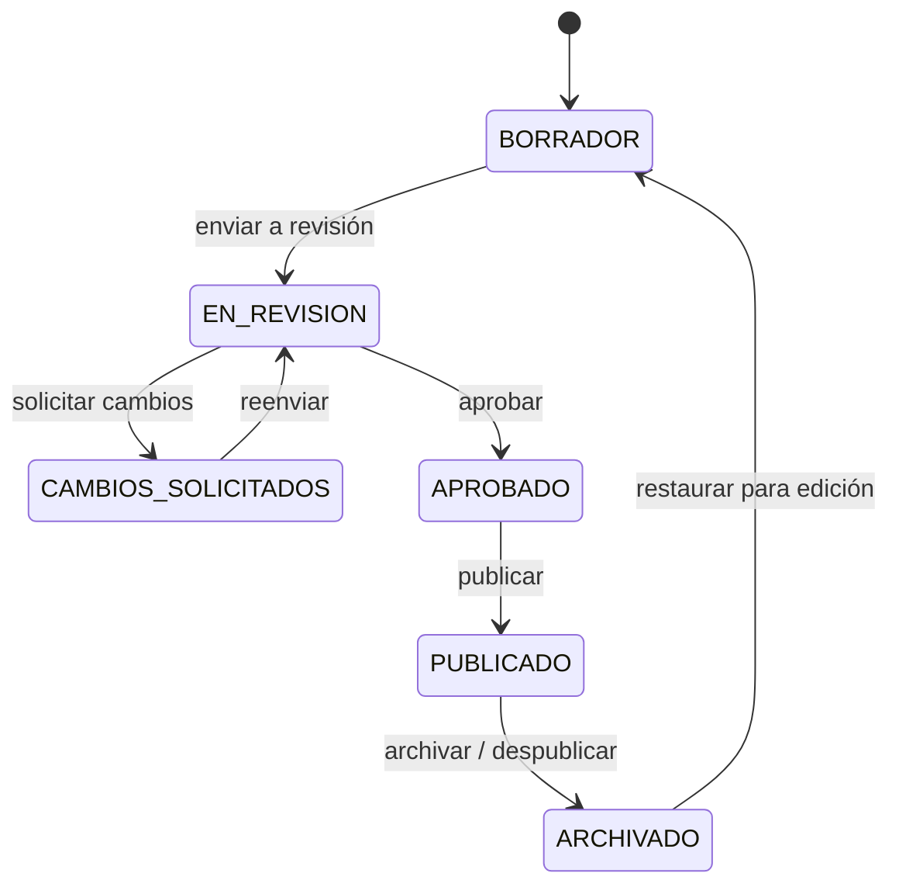

# Panel administrativo y CMS — definición de entregable

**Producto:** Plataforma de Medicina  
**Estado:** Propuesta funcional y técnica  
**Fecha:** 29 de octubre de 2026

## 1. Objetivo

Incorporar una zona administrativa privada para operar la plataforma sin editar directamente la base de datos ni ejecutar migraciones para el trabajo cotidiano. El panel permitirá administrar usuarios, contenido educativo y la operación básica del sistema, siempre bajo permisos explícitos y aplicados también en la API.

El módulo se construirá dentro del monolito actual: Angular para la interfaz y Spring Boot para la API. No implica pagos, suscripciones, expedientes clínicos ni herramientas de diagnóstico.

## 2. Principios de seguridad y operación

- La API es la autoridad final: ocultar una opción en la interfaz nunca sustituye verificar el permiso en el backend.
- Cada cuenta tiene un rol principal y permisos derivados de ese rol. En una fase posterior podrán asignarse permisos adicionales de forma individual si el negocio lo requiere.
- Las acciones relevantes generan una bitácora de auditoría: quién hizo qué, sobre qué recurso, cuándo y, para cambios, valores anteriores y nuevos sin incluir contraseñas ni secretos.
- No se eliminan físicamente contenidos ni cuentas desde el panel. Se desactivan o archivan para conservar trazabilidad y evitar romper progreso, referencias o auditoría.
- Un administrador no puede modificar su propio rol, desactivar su propia cuenta ni reducir sus propios privilegios en una acción que deje al sistema sin administrador activo.
- Al menos una cuenta con rol `SUPER_ADMIN` debe permanecer activa.
- Las acciones destructivas o de alto impacto requieren confirmación explícita en la interfaz.

## 3. Roles propuestos

| Rol | Finalidad | Alcance resumido |
|---|---|---|
| `ALUMNO` | Usuario final de aprendizaje. | Consulta contenido publicado autorizado por su tier; administra sólo su perfil y progreso. |
| `AUTOR_CONTENIDO` | Redactor o creador de contenido. | Crea y edita sus propios borradores; los envía a revisión; no publica ni administra usuarios. |
| `REVISOR_MEDICO` | Revisión editorial y clínica. | Consulta borradores asignados, solicita cambios, aprueba o rechaza contenido; no publica ni altera usuarios. |
| `EDITOR_CONTENIDO` | Operación editorial. | Crea, edita, archiva y publica contenido; administra categorías y puede reasignar autores/revisores. |
| `SOPORTE` | Atención operativa a usuarios. | Consulta usuarios y su estado; puede bloquear/desbloquear cuentas y restablecer acceso mediante el flujo aprobado; no ve contraseñas ni modifica roles, tiers o contenido. |
| `ADMIN_USUARIOS` | Administración de cuentas y acceso. | Consulta y gestiona usuarios, roles permitidos, tiers y estado de cuenta; consulta actividad y bitácora; no gestiona contenido. |
| `ADMIN_PLATAFORMA` | Administración diaria de la plataforma. | Combina permisos de `ADMIN_USUARIOS` y `EDITOR_CONTENIDO`; consulta métricas y bitácora; no puede otorgar ni revocar `SUPER_ADMIN`. |
| `SUPER_ADMIN` | Custodia técnica y de seguridad. | Acceso total, incluida la gestión de roles administrativos, configuración operativa y auditoría completa. Debe usarse por un grupo muy reducido. |

### Decisiones de diseño de roles

- `ADMIN` existente se migrará conceptualmente a `ADMIN_PLATAFORMA`; durante la implementación se definirá una migración compatible para las cuentas existentes.
- El rol no sustituye el tier. El tier continúa definiendo el contenido de aprendizaje al que accede un `ALUMNO`; los roles administrativos regulan capacidades de operación.
- Los roles editoriales (`AUTOR_CONTENIDO`, `REVISOR_MEDICO`, `EDITOR_CONTENIDO`) no conceden acceso automático a datos personales de los alumnos, salvo la información estrictamente necesaria para una tarea asignada.
- Para la primera versión, cada cuenta tendrá un solo rol. Si se necesita que una persona combine responsabilidades, se asignará el rol de mayor alcance apropiado; el modelo de permisos individuales se considerará una mejora posterior.

## 4. Matriz de permisos

Leyenda: **Propio** = sólo recursos creados/asignados a la persona; **Todos** = todos los recursos; **—** = sin permiso.

| Permiso | Alumno | Autor | Revisor | Editor | Soporte | Admin usuarios | Admin plataforma | Super admin |
|---|---|---|---|---|---|---|---|---|
| Ver panel administrativo | — | Sí | Sí | Sí | Sí | Sí | Sí | Sí |
| Ver usuarios | Propio | — | — | — | Todos (limitado) | Todos | Todos | Todos |
| Ver actividad de usuarios | Propio | — | — | — | Limitada | Sí | Sí | Sí |
| Crear usuarios administrativos | — | — | — | — | — | Roles no críticos | Roles no críticos | Sí |
| Editar nombre, tier o estado de usuario | Propio | — | — | — | Estado únicamente | Sí | Sí | Sí |
| Asignar o revocar roles | — | — | — | — | — | No críticos | No `SUPER_ADMIN` | Sí |
| Crear contenido | — | Propio | — | Sí | — | — | Sí | Sí |
| Editar contenido | — | Propio en borrador | Asignado, comentarios | Todos | — | — | Todos | Todos |
| Enviar a revisión | — | Propio | — | Sí | — | — | Sí | Sí |
| Aprobar/rechazar revisión | — | — | Asignado | Sí | — | — | Sí | Sí |
| Publicar/despublicar | — | — | — | Sí | — | — | Sí | Sí |
| Archivar/restaurar contenido | — | Propio no publicado | — | Sí | — | — | Sí | Sí |
| Ver auditoría | — | Propia | Asignada | Editorial | — | Sí | Sí | Sí |
| Configurar catálogos operativos | — | — | — | Limitado | — | Limitado | Sí | Sí |
| Gestionar configuración sensible | — | — | — | — | — | — | — | Sí |

### Permisos atómicos para la API

La implementación debe expresar la matriz anterior en permisos verificables, por ejemplo:

- `admin.access`
- `users.read`, `users.update`, `users.status.update`, `users.role.assign`, `users.tier.assign`
- `content.read.admin`, `content.create`, `content.update.own`, `content.update.any`, `content.review`, `content.publish`, `content.archive`
- `audit.read.own`, `audit.read`
- `catalogs.read`, `catalogs.update`
- `settings.read`, `settings.update`

Los nombres definitivos pueden ajustarse a las convenciones del código, pero deben conservar esta separación de capacidades.

## 5. Módulos del panel

### 5.1 Inicio administrativo

Ruta propuesta: `/admin`.

Muestra sólo indicadores autorizados para el rol actual:

- Usuarios activos, nuevos registros y cuentas bloqueadas.
- Contenido por estado: borrador, en revisión, aprobado, publicado y archivado.
- Contenido pendiente de revisión y contenido con fecha de revisión vencida o próxima a vencer.
- Actividad reciente propia o del equipo, según permisos.
- Acciones rápidas: crear contenido, revisar pendientes o buscar usuario.

Las métricas deben ser agregadas; no se deben exponer datos personales a roles editoriales que no tengan permisos de usuarios.

### 5.2 Gestión de usuarios

Ruta propuesta: `/admin/usuarios`.

Funciones:

- Buscar, filtrar y paginar por nombre, correo, rol, tier, estado y fecha de alta/último acceso.
- Ver ficha administrativa con datos mínimos: identidad, correo, rol, tier, estado, fecha de registro, último acceso y resumen de actividad permitido.
- Activar, bloquear o desbloquear una cuenta con motivo obligatorio.
- Cambiar tier cuando el rol lo permita, conservando auditoría.
- Asignar o revocar roles conforme a la jerarquía del administrador.
- Crear cuentas administrativas mediante invitación o alta controlada; nunca mostrar, almacenar o reenviar contraseñas en texto plano.
- Exportación queda fuera de la primera entrega salvo aprobación expresa, por el riesgo de tratamiento masivo de datos personales.

Restricciones:

- `SOPORTE` verá datos de contacto y estado, pero no roles administrativos, bitácora completa ni información no necesaria para atender al usuario.
- Ningún rol puede desactivar o degradar el último `SUPER_ADMIN` activo.
- Las cuentas bloqueadas no pueden iniciar sesión; la sesión existente deberá invalidarse conforme a la política de seguridad.

### 5.3 Gestión editorial de contenido

Rutas propuestas: `/admin/contenido`, `/admin/contenido/nuevo`, `/admin/contenido/:id/editar`.

El listado permite buscar y filtrar por título, área médica, autor, revisor, tier mínimo, estado, fecha de revisión y fecha de actualización. Cada fila muestra acciones sólo si el rol tiene permiso.

El formulario debe cubrir el modelo actual de contenido:

- Título y slug (generado desde el título, editable con validación de unicidad).
- Área médica y tier mínimo.
- Objetivo de aprendizaje, resumen, puntos clave y aplicación clínica.
- Método de aprendizaje, inicialmente sólo `LECTURA_GUIADA`.
- Tiempo de lectura.
- Fuente: título, autores, URL, DOI, fecha de publicación y fecha de revisión.
- Autor, revisor asignado, estado editorial y notas internas de revisión.

Validaciones mínimas:

- Los campos que actualmente son obligatorios en la base de datos se mantienen obligatorios antes de publicar.
- URL y DOI se validan por formato cuando se proporcionen.
- Tiempo de lectura debe ser mayor a cero.
- El contenido publicado requiere fuente y fecha de revisión vigentes.
- El slug debe ser único y conservar el formato actual de URL.

#### Flujo editorial

Se amplía el estado técnico actual (`BORRADOR`, `PUBLICADO`) a un flujo operativo. La migración deberá preservar los contenidos existentes.



- Un autor puede crear, editar su borrador y responder cambios solicitados.
- Un revisor no modifica el texto final directamente; registra comentarios y aprueba o devuelve el contenido.
- Un editor puede reasignar responsables, corregir contenido, publicar, despublicar y archivar.
- Todo contenido público debe estar en estado `PUBLICADO` y mantener una revisión aprobada.
- `ARCHIVADO` deja de aparecer en el catálogo y no se puede consultar como nuevo contenido; los usuarios con progreso previo conservan una referencia histórica legible según la política que se defina en implementación.
- La eliminación física no forma parte de esta entrega. El botón de "eliminar" en UI, si se expone, debe ejecutar archivado y explicarlo claramente.

### 5.4 Usuarios activos y actividad

Ruta propuesta: `/admin/actividad`.

Se consideran activos los usuarios con `last_login_at` dentro de un periodo configurable; propuesta inicial: últimos 30 días. El panel mostrará conteos por rol, tier y estado, además de una lista paginada de usuarios activos autorizada por rol.

No se implementará presencia en tiempo real en esta fase. Si se requiere el concepto de "conectado ahora", deberá definirse una señal de actividad, expiración y consideraciones de privacidad específicas.

### 5.5 Bitácora de auditoría

Ruta propuesta: `/admin/auditoria`.

Se registrarán como mínimo:

- Inicio y cierre de sesión administrativos, incluidos intentos fallidos relevantes según la política de seguridad.
- Creación, cambio de rol, tier, activación, bloqueo y desbloqueo de usuarios.
- Creación, edición, cambio de estado, publicación, archivado y restauración de contenido.
- Cambios de configuración y catálogos.

Campos sugeridos: identificador, fecha/hora, actor, rol del actor, acción, tipo e identificador del recurso, resumen, motivo cuando aplique, dirección IP o metadatos técnicos sólo si están aprobados por la política de privacidad, y diferencias estructuradas para cambios permitidos.

La bitácora es de sólo lectura desde el panel y debe excluir contraseñas, cookies, tokens y contenido sensible.

## 6. Modelo de datos a extender

La implementación definitiva se versionará mediante migraciones. Se proponen las siguientes extensiones:

| Concepto | Cambio propuesto |
|---|---|
| Roles | Ampliar el dominio de `usuarios_sistema.rol` o normalizarlo en un catálogo, preservando las cuentas existentes. |
| Usuarios | Mantener `estado`, `tier_id` y `last_login_at`; añadir motivo y fecha de bloqueo si se requiere trazabilidad operativa. |
| Contenido | Añadir estado editorial, autor, revisor, fecha de envío/aprobación/publicación y fecha de archivado. |
| Revisión | Crear `contenido_revision` para comentarios, decisión, revisor y fecha; evita perder historial al sobrescribir un campo. |
| Auditoría | Crear `auditoria_evento` con actor, acción, recurso, fecha, motivo y cambios serializados de forma segura. |
| Catálogos | Mantener `tier`; las áreas médicas pueden continuar como texto en la primera versión o normalizarse si el catálogo se administrará desde el panel. |

Las entidades no deben exponerse directamente por la API. Se requieren DTOs específicos para vistas administrativas, con campos limitados por permiso.

## 7. API propuesta

Prefijo: `/api/v1/admin`. Todos los endpoints requieren sesión autenticada y el permiso correspondiente.

| Método | Endpoint | Permiso mínimo | Propósito |
|---|---|---|---|
| `GET` | `/dashboard` | `admin.access` | Métricas autorizadas para el rol. |
| `GET` | `/usuarios` | `users.read` | Listar usuarios con búsqueda, filtros y paginación. |
| `GET` | `/usuarios/{id}` | `users.read` | Ver ficha administrativa autorizada. |
| `PUT` | `/usuarios/{id}` | `users.update` | Actualizar campos permitidos, tier o estado según permiso. |
| `POST` | `/usuarios/{id}/bloquear` | `users.status.update` | Bloquear con motivo. |
| `POST` | `/usuarios/{id}/desbloquear` | `users.status.update` | Desbloquear con motivo. |
| `PUT` | `/usuarios/{id}/rol` | `users.role.assign` | Cambiar rol respetando jerarquía. |
| `GET` | `/contenido` | `content.read.admin` | Listar contenido incluyendo estados no públicos. |
| `POST` | `/contenido` | `content.create` | Crear borrador. |
| `GET` | `/contenido/{id}` | `content.read.admin` | Consultar contenido administrativo. |
| `PUT` | `/contenido/{id}` | `content.update.own` o `content.update.any` | Editar contenido permitido. |
| `POST` | `/contenido/{id}/enviar-revision` | `content.update.own` | Enviar a revisión. |
| `POST` | `/contenido/{id}/revision` | `content.review` | Aprobar o solicitar cambios. |
| `POST` | `/contenido/{id}/publicar` | `content.publish` | Publicar contenido aprobado. |
| `POST` | `/contenido/{id}/archivar` | `content.archive` | Archivar / despublicar. |
| `POST` | `/contenido/{id}/restaurar` | `content.archive` | Restaurar como borrador. |
| `GET` | `/actividad/usuarios` | `users.read` | Usuarios activos y métricas autorizadas. |
| `GET` | `/auditoria` | `audit.read` | Consultar bitácora con filtros y paginación. |

Las operaciones de transición deben ser endpoints explícitos, no una edición libre del campo `estado`; esto hace más claro el permiso requerido, facilita auditoría y evita saltos inválidos de estado.

## 8. Interfaz y navegación

El acceso al panel se ofrecerá desde el shell privado sólo a quienes tengan `admin.access`. Las rutas administrativas tendrán guardas de Angular para una experiencia coherente, pero el backend seguirá validando cada petición.

Navegación propuesta:

```text
/admin
├── /admin/usuarios
├── /admin/contenido
│   ├── /admin/contenido/nuevo
│   └── /admin/contenido/:id/editar
├── /admin/actividad
├── /admin/auditoria
└── /admin/configuracion       (sólo cuando el alcance se apruebe)
```

Requisitos de UX:

- Tablas responsivas con filtros, paginación y estados de carga, vacío y error.
- Etiquetas de estado claras y no dependientes únicamente del color.
- Confirmaciones para bloqueo, cambio de rol, publicación y archivado.
- Formularios con validación inmediata y mensajes que expliquen cómo corregir el dato.
- Registro del motivo en acciones sensibles.
- Accesibilidad de teclado, etiquetas de formulario y contraste suficiente.

## 9. Reglas de autorización

- Cada solicitud administrativa debe obtener el usuario actual desde la sesión y reevaluar su estado y permisos en servidor.
- El control de propiedad de contenido debe comprobar autor, asignación de revisión y estado actual; no basta con confiar en el identificador enviado por el cliente.
- Se restringirá la elevación de privilegios: un administrador sólo puede asignar roles que tenga permitido gestionar y nunca un rol superior al propio.
- Una cuenta bloqueada no puede operar el panel incluso si conservó una sesión previa.
- Los endpoints públicos de catálogo y aprendizaje seguirán respetando el estado publicado; ningún endpoint de alumno podrá exponer borradores o archivados.
- Los mensajes de error no deben revelar información innecesaria sobre usuarios, roles ni contenido restringido.

## 10. Fuera de alcance de esta entrega

- Pagos, facturación, suscripciones y asignación automática de tiers por compra.
- Presencia en línea en tiempo real, chat o mensajería interna.
- Edición colaborativa simultánea, control de versiones completo o comparación visual de versiones.
- Carga de archivos, imágenes, video o un gestor documental; el contenido inicial sigue siendo texto y enlaces.
- Eliminación física de contenido, usuarios o eventos de auditoría.
- Permisos personalizados por usuario, grupos, departamentos o múltiples roles por cuenta.
- Exportación masiva de datos personales.
- Integración con expedientes clínicos, pacientes o información clínica identificable.

## 11. Criterios de aceptación

### Acceso y roles

- Una cuenta `ALUMNO` no puede acceder a rutas ni endpoints administrativos.
- Cada rol ve únicamente los módulos y acciones definidos en la matriz, y la API devuelve `403` ante permisos insuficientes.
- Existe al menos una cuenta `SUPER_ADMIN` activa y no puede ser desactivada ni degradada si es la última.
- Los cambios de rol, tier y estado quedan auditados con actor, fecha y motivo cuando corresponda.

### Usuarios

- Un administrador autorizado puede buscar, filtrar y paginar usuarios sin recibir contraseñas, hashes, sesiones o datos no autorizados.
- Un administrador autorizado puede bloquear y desbloquear una cuenta; la cuenta bloqueada no puede usar recursos protegidos.
- Los roles de soporte sólo pueden efectuar las acciones asignadas y no pueden elevar privilegios ni modificar tiers.

### Contenido

- Un autor puede crear y guardar un borrador propio.
- Un revisor puede aprobar o solicitar cambios sólo en contenido asignado.
- Sólo un editor, administrador de plataforma o superadministrador puede publicar contenido aprobado.
- Un contenido archivado deja de estar disponible en el catálogo público y conserva registro de auditoría.
- Todas las transiciones inválidas de estado son rechazadas por el backend.
- El contenido publicado cumple las validaciones editoriales y de fuente requeridas.

### Actividad, auditoría y calidad

- El tablero muestra métricas congruentes con los permisos del usuario actual.
- La lista de usuarios activos usa una definición documentada basada en `last_login_at` y permite filtrar sin revelar datos innecesarios.
- La bitácora no permite edición desde la interfaz ni guarda secretos.
- La interfaz funciona en móvil y escritorio, presenta carga, vacío y error, y mantiene accesibilidad básica.
- Hay pruebas automatizadas de autorización y de las transiciones críticas: bloqueo, cambio de rol, revisión, publicación y archivado.

## 12. Orden sugerido de implementación

1. Definir migración de roles compatibles, permisos y cuenta inicial de `SUPER_ADMIN`.
2. Aplicar autorización centralizada en backend y guardas de ruta en frontend.
3. Implementar consulta y administración de usuarios con auditoría.
4. Extender el modelo de contenido y construir el flujo de borrador, revisión, publicación y archivado.
5. Construir las pantallas administrativas y controles de experiencia.
6. Agregar tablero, actividad de usuarios y consulta de auditoría.
7. Completar pruebas de seguridad, reglas de negocio y regresión sobre el flujo de aprendizaje existente.

## 13. Decisiones que deben confirmarse antes de desarrollo

- ¿Quiénes serán las primeras cuentas `SUPER_ADMIN` y cómo se custodiarán sus credenciales?
- ¿Un revisor médico puede aprobar su propio contenido o se exige separación obligatoria entre autor y revisor? Propuesta: exigir separación.
- ¿Cuál es el periodo oficial para definir "usuario activo"? Propuesta inicial: 30 días.
- ¿Qué política aplicará a usuarios con progreso sobre contenido archivado: conservar lectura, mostrar aviso o retirar acceso?
- ¿Qué áreas médicas y fuentes editoriales están aprobadas?
- ¿Se requiere flujo de invitación y restablecimiento de contraseña para personal administrativo desde la primera versión?

